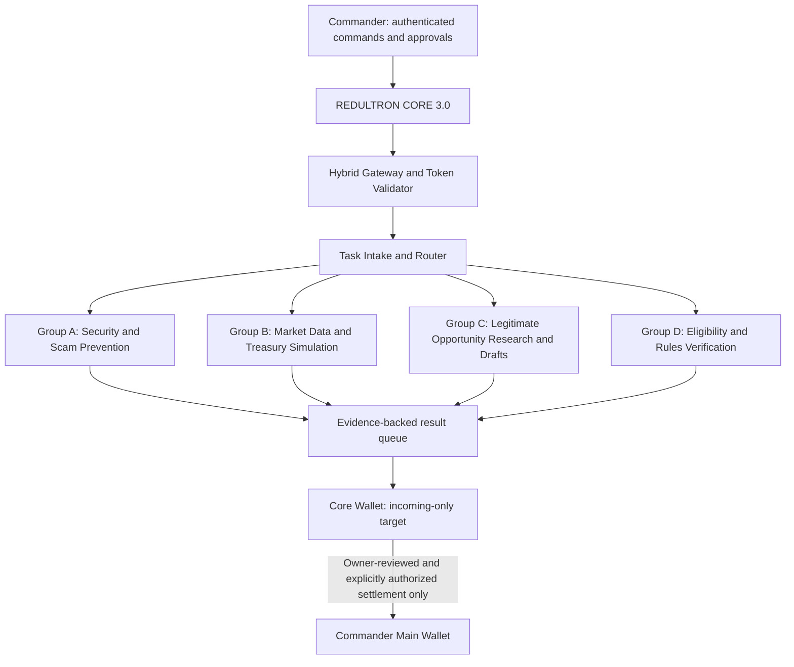

# REDULTRON CORE 3.0 — Authentication and Swarm Activation Gates

## Purpose
Document the target flow for fixing `401 OWNER_AUTH_REQUIRED`, validating task intake, and safely testing the four registered agent groups. This is an implementation plan, not a claim that the runtime has been fixed or agents are active.

## Target architecture

## Gate 0 — Authentication diagnosis
- Reproduce the last known failure: authenticated hybrid endpoint returned HTTP 401 `OWNER_AUTH_REQUIRED`.
- Inspect the request's expected auth mechanism, token source, header/cookie name, issuer/audience or shared-secret validation, expiry, and Worker environment binding names.
- Compare configuration names and runtime behavior without printing token values or secrets.
- Verify the request is signed/authorized by the owner; do not bypass the check or weaken fail-closed behavior.
- PASS only when a valid owner-authenticated request succeeds and missing, expired, malformed, or wrong-owner credentials are rejected.

## Gate 1 — Task intake and routing
- Validate a task schema, bounded payload size, allowed task type, deadline, and idempotency key.
- Require a known registry agent and action allowlist; fail closed for unknown agents or missing registry.
- Keep tasks in research, analysis, drafting, and simulation scope initially.
- Record task ID, agent/group, timestamp, result status, source evidence, and redacted error details.
- Add bounded retries, duplicate suppression, rate limits, cancellation, and an emergency-stop switch.
- Do not send tasks to unprovisioned slots. Registry count is 90, but provisioned count is currently 0.

## Gate 2 — Group validation
- Group A (20): security, privacy, scam screening.
- Group B (25): public market research and mock treasury calculations only.
- Group C (30): opportunity research and draft deliverables only.
- Group D (15): independent source, eligibility, terms, deadline, and payout verification.
- Start with one test worker per group in a non-production environment. Expand only after evidence-backed tests pass.
- Require Group D or a human reviewer to independently verify revenue recommendations; no self-approval for risky proposals.

## Gate 3 — Wallet boundary
- Agents must not hold private keys, seed phrases, recovery codes, exchange credentials, or signing authority.
- The Core wallet is a target for incoming funds only; no agent-initiated withdrawals, transfers, trades, token approvals, or contract calls.
- Any settlement from Core wallet to the Commander wallet requires authenticated owner approval and independent checks of network, destination, amount, fees, and transaction status.
- Never receive-and-forward money for an unknown third party. Reject suspicious or unexplained sources.
- Live financial execution remains disabled; use mock balances until wallet ownership, address/network checks, auditability, emergency stop, and recovery are independently tested.

## Evidence required for completion
- HTTP request/response status and redacted headers for valid and invalid auth cases.
- Test run IDs and exact test results for task schema, allowlist, idempotency, retry limit, cancellation, audit persistence, and emergency stop.
- Demonstration that agent dispatch is disabled before provisioning and enabled only for approved test workers.
- A wallet simulation showing incoming-only permissions and rejected outgoing actions.
- Production status must be reported separately from branch CI. Do not call a documentation commit or passing unit tests a live deployment.

## Current verified baseline
- Registry mode: `registry-only`.
- Agent slots: 90; provisioned agents: 0.
- Automatic dispatch: disabled.
- Financial execution: simulation-only.
- Last recorded Live Gateway Probe failed the authenticated hybrid endpoint with HTTP 401 `OWNER_AUTH_REQUIRED`.
- Policy gate is a decision function; it is not an executor and returns `EXECUTOR_NOT_CONNECTED` for privileged actions.
- Therefore: authentication fix = BLOCKED until retested; autonomous dispatch = BLOCKED; live wallet flow = NOT TESTED.
